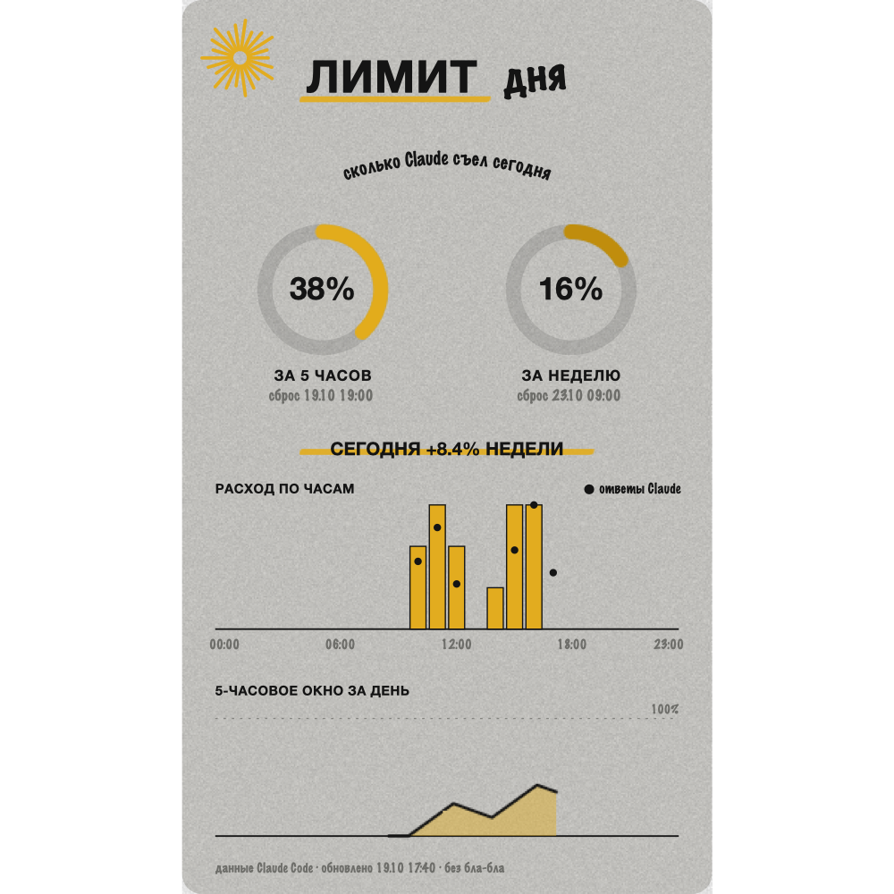

# Лимит дня

Мод для Claude Code: показывает, сколько лимита подписки Claude уже потрачено,
и рисует графики расхода за сегодня.



## Что показывает

- **За 5 часов** и **за неделю**: сколько процентов лимита использовано и когда он сбросится.
- **Расход по часам**: на сколько вырос недельный лимит за каждый час дня.
- **Ответы Claude** по часам (черные точки).
- **5-часовое окно** в течение дня (линия).
- Строку под полем ввода: «Лимит: 5 ч 34% · неделя 12%».

Цифры берутся из самого Claude Code, это те же данные, что в настройках лимитов.
Мод запоминает их по ходу дня, поэтому графики заполняются с момента установки.
Данные хранятся только у вас на компьютере.

## Установка

**Самый простой способ.** Откройте Claude Code (в приложении Claude это вкладка Code) и напишите обычными словами:

```
Установи мод limit-dnya из маркетплейса rimmacfo2026-cmyk/limit-dnya
```

Claude сам выполнит команду установки. Потом введите `/reload-plugins` и `/limit`.

**Командой.**

В Claude Code, в поле ввода:

```
/plugin install limit-dnya --marketplace rimmacfo2026-cmyk/limit-dnya
```

Подтвердите добавление маркетплейса (`y`) и выберите область установки.

Или из терминала:

```
claude plugin install limit-dnya --marketplace rimmacfo2026-cmyk/limit-dnya
```

Нужен Claude Code 2.1.287 или новее и подписка Claude (на API-ключе лимитов подписки нет).

## Как пользоваться

Введите `/limit`, откроется панель «Лимит дня».
В приложении Claude (вкладка Code) панель рисуется с графиками, в терминале упрощенно.

## Безопасность

Мод только читает цифры лимитов и пишет их в свое хранилище. Он не читает файлы,
не ходит в интернет и не меняет ваши запросы. Проверить это можно до установки:

```
claude plugin validate .
```

## Лицензия

MIT
